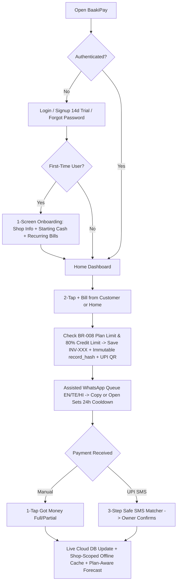

# Product Requirements Document (PRD): BaakiPay

## 1. Document Information & Version History
| Field | Details |
| :--- | :--- |
| **Product Name** | **BaakiPay** |
| **Tagline** | *Every rupee, right on time.* |
| **Document Version** | 1.5 (Final Sealed Release 1.0 — Implementation-Ready) |
| **Date** | 21 November 2026 |
| **Status** | Sealed & Ready for Milestone 1 |

---

## 2. Executive Summary & Product Overview
**BaakiPay** is a responsive, mobile-first, multi-language (**English, తెలుగు, हिन्दी**) web application built as a **One-Person Back Office** for **1–5 person Indian neighborhood Kirana and packaged-goods retail shops**.

Unlike backward-looking digital ledgers (which only record past *udhaar* credit), BaakiPay combines **itemized credit invoicing with unique UPI QR codes**, an **assisted 1-tap WhatsApp follow-up queue with 24-hour cooldown**, **safe 3-step UPI SMS payment matching**, **30/60/90-day cash-flow forecasting with "What-If" simulations**, **proactive credit-limit alerts**, and **self-generated business health summary PDFs**—all backed by a private, cloud-hosted PostgreSQL database (**Neon**) with strict per-shop data isolation and shop-scoped offline caching.

---

## 3. Problem Statement & Grounded Market Evidence
*All market statistics below are cited from publicly available industry reports for reference purposes only.*

Small Indian retail shops rarely fail from a lack of customers—they fail because **customer credit (*udhaar*) arrives late while rent, staff salaries, and distributor bills arrive on time**.

* **Rising Credit Exposure (PwC India — *The Retail Reinvention Paradigm*, Feb 2025):** To retain buyers against quick commerce, neighborhood shopkeepers are extending monthly customer credit from ₹10,000–₹12,000 up to ₹30,000 per customer on 30–40 day terms (p. 5). **36% of shoppers** choose local shops specifically for monthly credit (pp. 31–32), while **44% of retailers** owe credit to suppliers/distributors and **64% self-fund** operations from personal savings (pp. 26–27).
* **Massive Underserved Digital Market:** India's General Trade is projected to grow from **$932B (FY25P) to $1,338B (FY30P)**, yet **53% of traditional stores** use zero technology today and **59–60%** actively want better tech tools (PwC India 2025, pp. 7, 16–17, 29–30).
* **Working Capital & Credit Gap:** [Deloitte India (Oct 2025)](https://www.deloitte.com/in/en/our-thinking/spotlight-on-indian-economy/india-economic-outlook-october-2025.html) highlights an **₹30 lakh crore MSME credit deficit**, with only 18% using digital lending platforms. [TransUnion CIBIL (Dec 2025)](https://www.transunioncibil.com/content/dam/transunion-cibil/corporate/documents/msme-report-apr.pdf) reports individual secured (+43% YoY) and unsecured (+33% YoY) business loans surging as owners bridge cash crunches personally.
* **Cash-Flow Underwriting Trend:** [HDB / CRISIL (June 2025)](https://www.hdbfs.com/sites/default/files/investor-service/IndustryReportJune2025.pdf) confirms lenders increasingly evaluate cash-flow records for MSMEs, while the [Ministry of MSME Annual Report 2025–26](https://www.msme.gov.in/static/uploads/2026/05/1bfda06b460e72543530b40817573495.pdf?_gl=1*ijpb14*_ga*ODgwMjkyOTQyLjE3ODI2NTg1OTM.*_ga_4858QHF08F*czE3ODI5NzE5MzUkbzIkZzEkdDE3ODI5NzIzNzgkajUzJGwwJGgw) underscores persistent MSME cash-flow stress.
* **Competitive Whitespace ([2026 Indian Billing App Pricing](https://vanijbill.com/blog/billing-app-pricing-compared/)):** Khatabook/OkCredit act as free backward-looking ledgers; Vyapar (₹4,399–₹4,799/yr discounted) and myBillBook (₹291–₹333/mo annual) focus on GST accounting. None provide a simple, forward-looking **30–90 day cash survival simulator** built for a 1-person counter.

---

## 4. Product Vision, Monetization Model & Success Metrics
* **Vision:** Become the default daily cash-flow back office for India's independent neighborhood retail shops.
* **Monetization Model (Value-Gated, Trust-First SaaS Pricing):**
  * **14-Day Free Pro Trial (`plan = 'trial'`, `trial_expires_at = created_at + 14 days`):** Every new shop starts with full Pro access for 14 days so the owner experiences 30–90 day forecasting and WhatsApp reminders immediately.
  * **Free Starter Plan (`effectivePlan = 'free'`, ₹0 forever):** Basic credit ledger, up to **10 itemized invoices per calendar month** (enforced in `API-007` with *"Powered by BaakiPay"* footer on PDFs), manual payment recording, and a **7-day cash snapshot** (enforced in `API-012`, with `whatIfAvailable: false`).
  * **BaakiPay Pro (`plan = 'pro'`, ₹199/month or ₹1,999/year):**
    * **Unlimited itemized invoices** with clean, watermark-free PDFs and custom Shop Bio/Address.
    * **30 / 60 / 90-Day Cash-Flow Forecast & "What-If" Simulator** *(requires the entire shop's receivables and expenses in one unified account)*.
    * **Safe 3-Step Auto-Match UPI SMS** & **Multi-Language Assisted WhatsApp Reminder Queue (`English · తెలుగు · हिन्दी`)**.
    * **Business Health Analytics, Smart Tips & Self-Generated Business Health Summary PDF**.
  * **Clear Downgrade Rule (Trust Guarantee):** When `NOW() > trial_expires_at` without upgrading, `effectivePlan` automatically resolves to `'free'` and **owners are NEVER locked out of their data**. All existing customers, invoices, and payment history remain 100% readable and editable; only Pro-exclusive capabilities (30–90d forecast, What-If toggles, and >10 new invoices/month) display a clear upgrade option.
* **Success Metrics (KPIs):**
  * Time to create and share an itemized invoice (from Customer card): **2 taps / < 20 seconds**.
  * Time to spot a 30–90 day cash shortfall, 80%+ credit alerts, and top 3 debtors to chase: **< 3 seconds** on Home screen.
  * Zero unauthorized cross-shop data reads, cache bleed, or plan-field tampering (**100% `shop_id` isolation**).
  * 100% passing unit tests on cash-flow forecasting, What-If simulation, 3-step UPI SMS matching, `effectivePlan` gating, and immutable `record_hash`.

---

## 5. Target Audience, Persona & User Roles
* **Primary Persona:** **Ramesh Rao**, owner of **Sri Lakshmi Kirana & Provisions, Madhapur, Hyderabad** (3 staff, no accountant, ₹1.8L/month credit volume, manages ~12–40 regular monthly *udhaar* families alongside weekly distributor bills, rent, and staff salaries).
* **Sample Verification Account (Pre-Seeded Synthetic Data):** `lakshmi@baakipay.in` / `BaakiPay@2026` (`plan = 'pro'`, pre-loaded with 12 synthetic customers—including both *Rahul Sharma* and *Rahul Verma*—18 synthetic itemized invoices across 3 months, 5 overdue bills, and 5 recurring shop expenses for immediate end-to-end verification).
* **User Roles & Permissions:**
  * **Authenticated Shop Owner (`shop_id`):** Full CRUD access **strictly scoped to their own `shop_id`** (customers, invoices, payments, expenses, profile, settings). Zero access to any other shop's records; cannot directly modify `plan` or `trial_expires_at`.
  * **Unauthenticated Visitor:** Access only to Login, Signup, and Forgot Password screens.

---

## 6. Scope, Out-of-Scope & Engineering Constraints

### In-Scope (Release 1.0 — Locked)
1. Multi-user Signup (sets `plan = 'trial'` and `trial_expires_at = NOW() + 14 days`), Login, Logout, **Guided 1-Screen Onboarding** (Shop Name, Owner Name, Starting Cash, Default Credit Rules, **plus quick recurring expense fields for Rent, Staff & Main Supplier**), and Forgot Password (sandbox OTP `123456` gated behind an `otpService` adapter for production swap to MSG91/Email OTP).
2. Strict cloud database isolation per `shop_id` on **Neon PostgreSQL**.
3. Home Dashboard with 3 KPI cards, cash preview chart, Cash Safety Badge, **Proactive 80%+ Credit Limit Warnings**, and **Today's Assisted Reminder Queue** (Top 3 urgent debtors with 24-hour reminded cooldown).
4. Customers ("Who Owes Me") directory with search, filters (`All`, `Late`, `Near Limit`), credit-limit progress bars, and **2-tap `+ Bill` (pre-selecting that customer)**, `Got Money`, and `WhatsApp` buttons.
5. Free-type Itemized Credit Invoice Creator (enforcing the 10/month Free Starter cap via `BR-008`, remembered `<datalist>` item suggestions, quantity, price, discount, due date, and **pre-save 80%+ credit-limit warning**), Printable Invoice PDF, Unique UPI QR (`upi://pay?...&tn=INV-XXX`), and Assisted WhatsApp Click-to-Chat reminders (3 tones × 3 languages).
6. Full/Partial Payment Recording ("Got Money") + Safe 3-Step **Auto-Match UPI SMS** (with Multi-Name / Partial-Payment Owner Confirmation guardrail).
7. Plan-aware Cash-Flow Forecast Engine (30/60/90 days + What-If toggles for `trial`/`pro`; 7-day snapshot + `whatIfAvailable: false` for `free`, with warning banner if ₹0 expenses are entered).
8. My Bills (Upcoming Shop Expenses: Rent, Staff, Suppliers, Utilities) with Add & Mark Paid.
9. Business Health Analytics (Monthly Turnover, Cash Collected, Net Surplus, Month-by-Month Bar Chart, Rule-Based Smart Tips) + 1-Click Printable **Self-Generated Business Health Summary PDF** (with immutable `record_hash` and clear non-audited disclaimer).
10. Settings & Shop Profile: Instant **English · తెలుగు · हिन्दी** UI switcher, Shop Bio, Shop Address (with optional Google Maps link), UPI ID, Starting Cash, Default Credit Rules, and Collapsible FAQ/Helpline/Disclaimer.
11. Responsive layout (Phone, Tablet, Desktop), Pulsing **Skeleton Loaders**, and **Shop-Scoped Offline-Aware Read Cache** (`baakipay_${shop_id}_${resource}`).

### Strictly Out-of-Scope (Release 1.0 — Do NOT Build)
* No bank account numbers or IFSC collection (UPI ID only).
* No paid third-party APIs (no external LLM APIs, no paid WhatsApp Business API, no Twilio SMS, no payment gateway KYC, no paid Google Maps API).
* No image/photo uploads, voice-mic transcription on Bio, CSV export, barcode scanners, or stock-quantity inventory tracking.
* No customer-facing login portal and no "Demo Mode" / "Reset Demo" buttons in the UI.

### Lean Engineering & Token-Efficiency Constraints (MANDATORY)
* **CON-001 (Lean File Structure):** Keep the codebase compact (~14–16 focused files total). Avoid unnecessary boilerplate, Storybook, Docker, or Redux.
* **CON-002 (Small Modular Files):** Keep every source file under **200 lines** where practical for clean maintainability and minimal context overhead.
* **CON-003 (Surgical Edits Only):** Modify **only** the target files for each milestone. Never rewrite unrelated working files.
* **CON-004 (Plan Before Code):** Present a concise 5-bullet plan before applying file edits, then verify with tests after each milestone.
* **CON-005 (Zero Paid Dependencies):** Use only free, standard npm packages (`react`, `vite`, `tailwindcss`, `recharts`, `lucide-react`, `qrcode.react`, `express`, `pg`, `bcryptjs`, `jsonwebtoken`, `cors`, `dotenv`, `vitest`).

---

## 7. Functional Requirements Matrix

| ID | Priority | Feature Area | Requirement Summary |
| :--- | :--- | :--- | :--- |
| **FR-001** | P0 | Auth & Privacy | Shopkeeper signup (setting 14-day `trial_expires_at` + displaying privacy notice), login, logout, and JWT-protected routes ensuring strict `WHERE shop_id = $1` isolation on every query. |
| **FR-002** | P0 | Guided Onboarding | First-time 1-screen setup capturing Shop Name, Owner Name, Starting Cash (₹), Default Credit Rules, and quick recurring shop bills (Rent, Staff Salary, Main Supplier) so forecasts work accurately from minute one. |
| **FR-003** | P1 | Forgot Password | Modular `otpService` adapter: in sandbox mode displays *"OTP sent to registered phone/email"* with explicit sandbox note (`Use OTP: 123456`); ready for MSG91/Email OTP drop-in before live public launch. |
| **FR-004** | P0 | Home Dashboard | Display Cash in Hand, Total Receivables ("Who Owes Me"), Next 14-Day Bills Due, Cash Health Badge, **80%+ Credit Limit Alert Banner**, cash preview chart, and **Today's Assisted Reminder Queue** (Top 3 debtors excluding items reminded within 24 hours). |
| **FR-005** | P0 | Customer Directory | Add/edit/search/filter customers (`All`, `Late`, `Near Limit`) showing total owed, max days overdue, optional UPI ID, color-coded credit-limit bar, and **2-tap `+ Bill` (pre-selecting that customer)**. |
| **FR-006** | P0 | Itemized Invoicing | Free-type multi-row credit invoice creator (`Item Name` with remembered `<datalist>` suggestions, `Qty`, `Unit Price`, `Discount`) auto-calculating total, due date, unique `INV-XXX` code, immutable `record_hash`, **80%+ credit-limit warning**, and **10/month Free Starter cap** (`BR-008`). |
| **FR-007** | P0 | Invoice Proof & UPI QR | Printable/PDF invoice modal displaying Shop Name, Bio, Address, Itemized Table, Discount, Grand Total, Due Date, and dynamic scannable UPI QR (`upi://pay?pa={upiId}&pn={shopName}&am={balanceDue}&cu=INR&tn={invoiceCode}`). |
| **FR-008** | P0 | Assisted WhatsApp Queue | Transparently assisted (not auto-sent) 1-tap WhatsApp reminders in **3 tones** (*Gentle*, *Firm*, *Urgent*) and **3 languages** (*English*, *Telugu*, *Hindi*) referencing invoice code, amount, and due date. **Both** **Copy** and **Open WhatsApp** (`https://wa.me/91...`) call `POST /api/invoices/:id/remind` to set `last_reminded_at` for a **24-hour queue cooldown**. |
| **FR-009** | P0 | Payment Recording | Record full or partial payments ("Got Money") with mode (`Cash` or `UPI`), updating invoice balance, status (`UNPAID`, `PARTIAL`, `PAID`), shop Cash in Hand, and live forecast immediately without mutating `record_hash`. |
| **FR-010** | P0 | Safe 3-Step UPI SMS Match | Paste bank/UPI credit SMS to extract `₹` amount, sender name, and optional `INV-XXX` code; apply strict 3-step safety matching and **never** auto-clear without explicit 1-tap owner confirmation (handling duplicate names & partial payments safely). |
| **FR-011** | P0 | Plan-Aware Cash Forecast | Deterministic daily cash projection (**30/60/90 days** for `effectivePlan ∈ {'trial','pro'}`; **7-day snapshot** for `'free'`) combining starting cash, expected invoice inflows, and upcoming shop expenses, with a `₹0` danger line and a yellow warning if zero expenses are logged. |
| **FR-012** | P0 | "What-If" Simulator | Pro/Trial-gated interactive toggles comparing baseline vs. simulated cash line: (1) *Top customer pays 15 days late*, (2) *Bad Day: 5 customers pay 15 days late*, (3) *Give ₹15,000 more credit (paid back in 35 days)*; returns `whatIfAvailable: false` with upgrade card for `'free'` plans. |
| **FR-013** | P0 | Shop Expenses (My Bills) | Add, view, and mark paid recurring/one-off shop bills (Rent, Staff Salary, Wholesale Suppliers, Utilities) feeding directly into the forecast engine. |
| **FR-014** | P1 | Business Health & Summary PDF | Calculate Monthly Turnover, Cash Collected vs. Credit Lent, Net Surplus, Avg Daily Sales, Month-by-Month bar chart, rule-based business tips, and 1-click printable **Self-Generated Business Health Summary PDF** displaying immutable `record_hash` and a clear non-audited disclaimer. |
| **FR-015** | P0 | Settings, i18n & Offline Cache | Instant `EN · తె · हि` switcher across UI & reminders; Shop Profile (Bio, Address + Google Maps link, UPI ID, Cash, Credit Rules — strictly excluding `plan`/`trial_expires_at` from updates); shop-scoped offline read cache (`baakipay_${shop_id}_${resource}`); collapsible FAQ, Helpline & Legal Disclaimer. |

---

## 8. Business Rules & Exact Deterministic Formulas
* **BR-001 (Days Overdue):** `daysOverdue = max(0, floor((today - dueDate) / 86400000))` for invoices where `status != 'PAID'`.
* **BR-002 (Urgency Score & 24-Hour Reminder Cooldown):** `urgencyScore = balanceDue * (daysOverdue + 1)`. Home "Today's Assisted Reminder Queue" filters out invoices where `last_reminded_at > NOW() - INTERVAL '24 hours'` (showing a subtle *"Reminded today"* badge on the Customer card) and sorts remaining open invoices descending by `urgencyScore`.
* **BR-003 (Credit Limit Threshold Alert):** Trigger warning whenever `(customer.totalOwed + pendingInvoiceAmount) / customer.creditLimit >= 0.80` on both the Home dashboard and the Create Invoice drawer.
* **BR-004 (Daily Cash Projection — Plan-Aware 7 / 30 / 60 / 90 Days):**
  * Compute `effectivePlan` per `BR-008`. If `effectivePlan === 'free'`, clamp horizon `N = 7` days; for `trial` or `pro`, allow `N ∈ {30, 60, 90}` days.
  * Start `cash[0] = shop.cashInHand`.
  * For each day `d = 1..N`: `cash[d] = cash[d - 1] + sum(unpaidInvoices expected on day d) - sum(unpaidExpenses due on day d)`.
  * Overdue invoices (`dueDate < today`) are modeled as expected on `today + 3 days` in baseline (or shifted by `+15 days` when a late-payment What-If toggle is active).
  * If `unpaidExpenses.length === 0`, display an advisory banner: *"Add rent and supplier bills in My Bills for an accurate cash forecast."*
* **BR-005 ("What-If" Simulation Shifts & Plan Gate):**
  * What-If simulations are computed **only** when `effectivePlan ∈ {'trial', 'pro'}`. When `effectivePlan === 'free'`, `API-012` returns `whatIfAvailable: false` (omitting What-If series) and the UI renders an upgrade card in place of the toggles.
  * *Top Customer 15d Late:* Shift all open invoices of the highest-balance customer by `+15 days`.
  * *Bad Day (5 Customers Late):* Shift open invoices of the top 5 open-balance customers by `+15 days`.
  * *Give ₹15,000 more credit (paid back in 35 days):* Helper line reads *"You lend ₹15,000 more today, expected back in 35 days."* Deducts ₹15,000 from `cash[0]` today (working capital tied up in goods) and adds `+₹15,000` inflow on `day 35`.
* **BR-006 (3-Step Safe UPI SMS Matching Order):**
  1. **Regex Parse:** Extract numeric amount (`Rs.|INR|₹`), optional invoice code (`INV-\d+`), and sender name fragment.
  2. **Step 1 (Invoice Code Match):** If `INV-XXX` matches an open invoice for `shop_id`, present **1 exact match** for 1-tap owner confirmation.
  3. **Step 2 (Name + Amount Multi-Candidate Check):** If no `INV-XXX`, find **all** open invoices whose customer name matches the fragment (case-insensitive) OR whose exact `balanceDue === smsAmount`. Tag exact-amount matches as *"Full Payment Match"* and higher-balance matches as *"Possible Partial Payment"*.
  4. **Step 3 (Mandatory Human Confirmation):** If 2+ candidates exist (e.g., *Rahul Verma owes ₹5,000* and *Rahul Sharma owes ₹10,000* when ₹5,000 arrives from "Rahul"), display a yellow alert: *"Received ₹5,000 from 'Rahul' — multiple customers match. Select who paid:"* Never auto-clear without an explicit click.
* **BR-007 (Immutable `record_hash`):** Generated **once at invoice creation** as a deterministic SHA-256 hex string from immutable fields `shop_id | invoice_code | total_amount | created_at` (excluding `paid_amount` so partial payments never break the invoice's original verification hash), stored in `invoices.record_hash` and printed consistently as `record_hash` on the Self-Generated Business Health Summary PDF.
* **BR-008 (Effective Plan Resolution & Monthly Invoice Cap):**
  * Compute `effectivePlan = (shop.plan === 'trial' && NOW() > shop.trial_expires_at) ? 'free' : shop.plan`.
  * In `API-007 POST /api/invoices`, if `effectivePlan === 'free'`, count monthly invoices via `SELECT COUNT(*) FROM invoices WHERE shop_id = $1 AND created_at >= date_trunc('month', NOW())`. If `count >= 10`, reject with `HTTP 403` and `{ error: 'INVOICE_LIMIT_REACHED', upgradePrompt: true }`.

---

## 9. User Journeys & System Workflows

---

## 10. Industry-Standard UI/UX Design System

| Token | Value | Usage |
| :--- | :--- | :--- |
| **Primary Brand** | `#1E1B4B` (Deep Royal Indigo) | Desktop sidebar, login header, primary headings, active states |
| **Primary Accent** | `#F59E0B` (Warm Marigold Gold) | Primary CTA buttons (`+ Add Bill`, `Sign In`, `Download Summary PDF`) with `#0F172A` bold text |
| **App Background** | `#F8FAFC` (Ice Off-White) | Main canvas for high readability in bright shop light |
| **Card Surface** | `#FFFFFF` + `1px solid #E2E8F0` | All KPI cards, lists, charts, drawers (`12px–16px` border radius) |
| **Status: Safe / Paid** | `#16A34A` (bg `#DCFCE7`) | Cash in hand, paid badges, WhatsApp CTA (`#22C55E`) |
| **Status: Warning** | `#D97706` (bg `#FEF3C7`) | Near credit limit (`>= 80%`), offline banner, multi-Rahul disambiguation |
| **Status: Danger / Late** | `#DC2626` (bg `#FEE2E2`) | Overdue badges, `₹0` danger line, cash-crunch banner |
| **Typography** | `Plus Jakarta Sans`, `Noto Sans Telugu`, `Noto Sans Devanagari` | Loaded via Google Fonts; `tabular-nums` on all `₹` amounts |
| **Spacing & Touch** | 8px grid (`8/16/24px`); min button height `44px` | WCAG AA contrast (`>= 4.5:1`); icon + short text label on all actions |

### Mandatory UI States (`UI-001`..`UI-006`)
* **UI-001 (Skeleton Loaders):** Every screen (Home KPIs, Chart, Customers list, Bills list) renders animated pulsing gray skeleton placeholders (`animate-pulse`) during API fetches—never a blank white page.
* **UI-002 (Shop-Scoped Offline-Aware UX):** Cache latest API responses strictly under namespaced keys `baakipay_${shop_id}_${resource}` (e.g., `baakipay_${shop_id}_customers`, `baakipay_${shop_id}_forecast`) and clear the active session on logout so shared family devices never bleed data across accounts. When offline, render cached data for the active `shop_id` with an amber banner (*"Offline — showing last saved data"*) and disable write actions cleanly.
* **UI-003 (Responsive Breakpoints):** Phone (`< 768px`) uses a fixed 4-tab bottom bar + top bar (`EN · తె · हि`, Settings); Desktop (`>= 1024px`) uses a fixed `240px` Royal Indigo sidebar + 3-column KPI grid (`max-w-[1200px]`).
* **UI-004 (Empty States):** Clear icon + helpful guidance + direct CTA button.
* **UI-005 (Validation & Error States):** Inline red helper messages under invalid inputs; network errors show a friendly retry card.
* **UI-006 (Instant Feedback):** Non-blocking green confirmation toast after every saved bill, reminder cooldown, or payment.

---

## 11. Technical Architecture & Database Schema

### Confirmed Tech Stack (100% Free Launch, Zero-Code-Change Scale Path)
* **Frontend (`client/`):** React 18 + TypeScript + Vite + Tailwind CSS + Recharts + `qrcode.react` + `lucide-react` + Vitest.
* **Backend (`server/`):** Node.js + Express + `pg` (PostgreSQL pool) + `bcryptjs` + `jsonwebtoken` + `cors` + `dotenv`.
* **Cloud Database:** **Neon** Serverless PostgreSQL connected via `DATABASE_URL` in `.env` (git-ignored). *Capacity Note:* Neon's free tier provides 500 MB storage and serverless compute (comfortably supporting hundreds of early shops); scaling to thousands of active shops requires only upgrading the Neon plan via `DATABASE_URL` with zero application code changes.
* **Deployment:** **Render** Web Service serving built React static files + Express API under one HTTPS URL.

### PostgreSQL Database Schema (4 Normalized Tables)
1. **`shops`**: `id` (UUID PK), `email_or_phone` (VARCHAR UNIQUE NOT NULL), `password_hash` (TEXT NOT NULL), `shop_name` (VARCHAR), `owner_name` (VARCHAR), `bio` (TEXT), `address` (TEXT), `upi_id` (VARCHAR), `cash_in_hand` (NUMERIC DEFAULT 0), `default_credit_limit` (NUMERIC DEFAULT 15000), `default_due_days` (INT DEFAULT 30), `language` (VARCHAR DEFAULT 'en'), `plan` (VARCHAR DEFAULT 'trial' CHECK IN `'trial','pro','free'`), `trial_expires_at` (TIMESTAMP DEFAULT (NOW() + INTERVAL '14 days')), `onboarded` (BOOLEAN DEFAULT false), `created_at` (TIMESTAMP DEFAULT NOW()).
2. **`customers`**: `id` (UUID PK), `shop_id` (UUID FK → `shops.id` ON DELETE CASCADE), `name` (VARCHAR NOT NULL), `phone` (VARCHAR NOT NULL), `upi_id` (VARCHAR), `credit_limit` (NUMERIC DEFAULT 15000), `created_at` (TIMESTAMP DEFAULT NOW()).
3. **`invoices`**: `id` (UUID PK), `shop_id` (UUID FK → `shops.id` ON DELETE CASCADE), `customer_id` (UUID FK → `customers.id` ON DELETE CASCADE), `invoice_code` (VARCHAR NOT NULL), `items_json` (JSONB NOT NULL), `subtotal` (NUMERIC NOT NULL), `discount` (NUMERIC DEFAULT 0), `total_amount` (NUMERIC NOT NULL), `paid_amount` (NUMERIC DEFAULT 0), `due_date` (DATE NOT NULL), `status` (VARCHAR CHECK IN `'UNPAID','PARTIAL','PAID'`), `payment_mode` (VARCHAR), `last_reminded_at` (TIMESTAMP NULL), `record_hash` (VARCHAR NOT NULL), `created_at` (TIMESTAMP DEFAULT NOW()).
4. **`expenses`**: `id` (UUID PK), `shop_id` (UUID FK → `shops.id` ON DELETE CASCADE), `title` (VARCHAR NOT NULL), `category` (VARCHAR NOT NULL), `amount` (NUMERIC NOT NULL), `due_date` (DATE NOT NULL), `is_paid` (BOOLEAN DEFAULT false), `created_at` (TIMESTAMP DEFAULT NOW()).

---

## 12. REST API Specification (`API-001`..`API-013`)
All non-auth endpoints require `Authorization: Bearer <jwt>` and derive `shop_id` exclusively from the verified JWT payload.

| ID | Method & Endpoint | Purpose & Key Payload |
| :--- | :--- | :--- |
| **API-001** | `POST /api/auth/register` | Create shop account (`emailOrPhone`, `password`, `shopName`, `ownerName`, sets `plan = 'trial'` & `trial_expires_at = NOW() + 14 days`); returns JWT + shop profile + `effectivePlan`. |
| **API-002** | `POST /api/auth/login` | Authenticate shop; returns JWT + shop profile + computed `effectivePlan`. |
| **API-003** | `POST /api/auth/forgot-password` | Validate account exists; delegates to `otpService` (sandbox mode returns `sandboxOtpHint: "123456"`). |
| **API-004** | `POST /api/auth/reset-password` | Verify OTP via `otpService` + update `password_hash` in PostgreSQL. |
| **API-005** | `GET / PUT /api/shop/profile` | Read or update Shop Name, Owner, Bio, Address, UPI ID, Cash in Hand, Credit Rules, Language, `onboarded` (onboarding may seed initial recurring expenses). **Write-Protected:** `plan` and `trial_expires_at` MUST be excluded from the `PUT` whitelist and cannot be modified via this endpoint. |
| **API-006** | `GET / POST / PUT /api/customers` | List shop's customers with live `totalOwed`, `maxDaysOverdue`, and `nearLimit` flag; create or edit customer. |
| **API-007** | `GET / POST /api/invoices` | List invoices; create itemized invoice (enforces `BR-008` 10/month cap when `effectivePlan === 'free'`, returning `403 INVOICE_LIMIT_REACHED`, and auto-generates `INV-XXX` + immutable `record_hash`). |
| **API-008** | `POST /api/invoices/:id/pay` | Record full/partial payment (`amount`, `mode`); updates `paid_amount`, `status`, and increments `shops.cash_in_hand` (leaves `record_hash` untouched). |
| **API-009** | `POST /api/invoices/:id/remind` | Called by both **Copy** and **Open WhatsApp** buttons; sets `last_reminded_at = NOW()` to suppress that invoice from Today's Assisted Reminder Queue for 24 hours. |
| **API-010** | `POST /api/invoices/match-sms` | Parse pasted UPI/bank SMS text; returns 3-step matched candidates (`EXACT_INVOICE`, `SINGLE_CANDIDATE`, or `MULTIPLE_CANDIDATES`) without mutating data. |
| **API-011** | `GET / POST / PATCH /api/expenses` | List shop bills, add new bill, or mark bill paid (deducts from `shops.cash_in_hand`). |
| **API-012** | `GET /api/forecast` | Returns `effectivePlan`-aware daily cash array (7d + `whatIfAvailable: false` if `'free'`; 30/60/90d + What-If simulations + `whatIfAvailable: true` for `'trial'`/`'pro'`), top 3 urgent reminder queue items (respecting 24h cooldown), 80%+ credit-limit alerts, and crunch verdict. |
| **API-013** | `GET /api/analytics/summary` | Returns 3-month turnover series, cash collected vs. credit lent, net surplus, rule-based business tips, and Self-Generated Business Health Summary `record_hash`. |

---

## 13. Security, Privacy & Compliance Requirements
* **NFR-001 (Zero Credential Leakage):** `.env` (`DATABASE_URL`, `JWT_SECRET`, `OTP_PROVIDER`) MUST be listed in `.gitignore`. Provide `.env.example` with blank placeholders.
* **NFR-002 (SQL Injection Prevention):** All PostgreSQL queries MUST use parameterized queries (`$1, $2`).
* **NFR-003 (Password, OTP & Plan Write-Protection):** Passwords hashed with `bcryptjs` (10 salt rounds); JWT signed with `JWT_SECRET` (7-day expiry). Sandbox OTP (`123456`) is strictly disabled when `OTP_PROVIDER !== 'sandbox'`. `shops.plan` and `shops.trial_expires_at` are strictly write-protected from profile update endpoints.
* **NFR-004 (Synthetic Seed Data Only):** Pre-seeded sample shop (*Sri Lakshmi Kirana & Provisions, Hyderabad*, 12 synthetic customers, 18 synthetic invoices spanning 3 months, 5 overdue bills, 5 shop expenses) uses strictly fictional names, phones (`9000000001`–`9000000012`), and UPI IDs.
* **NFR-005 (Privacy & Data Retention):** BaakiPay collects only the minimum data required to operate each shop's back office. Shop owners may request full account and data deletion via the support helpline. Customer phone numbers are stored solely for assisted WhatsApp reminder generation and are never shared with third parties. A concise privacy notice is displayed on the signup screen.

---

## 14. Acceptance Criteria & QA Plan (`Given / When / Then`)
* **AC-001 (Multi-Shop Privacy & Cache Isolation):** *Given* Shop A and Shop B log in on the same browser, *When* Shop B queries APIs or enters offline mode, *Then* zero records from Shop A appear because both SQL queries and `baakipay_${shop_id}_*` cache keys are strictly isolated.
* **AC-002 (2-Tap Itemized Invoice + Credit Warning + UPI QR):** *Given* Srinu is at 85% of his ₹15,000 limit, *When* the owner taps `+ Bill` on Srinu's card, *Then* Srinu is pre-selected, an 80%+ warning banner appears, saving stores `INV-XXX` and immutable `record_hash` in Neon PostgreSQL, and a scannable UPI QR encoding `&tn=INV-XXX` renders.
* **AC-003 (24-Hour Reminder Cooldown on Copy & WhatsApp):** *Given* an overdue invoice appears in Today's Assisted Reminder Queue, *When* the owner taps either **Copy** or **Open WhatsApp**, *Then* `POST /api/invoices/:id/remind` sets `last_reminded_at` and removes that invoice from the queue for 24 hours.
* **AC-004 (Multi-Rahul Partial Payment Safety):** *Given* Rahul Verma owes ₹5,000 and Rahul Sharma owes ₹10,000, *When* the owner pastes *"Rs. 5,000 credited from Rahul"*, *Then* the system does NOT auto-clear either bill and displays both Rahuls for 1-tap owner selection.
* **AC-005 (What-If Simulator, Plan Gating & Missing Expense Guard):** *Given* a `trial`/`pro` shop with 5 open customers, *When* the user toggles *"Bad Day: 5 Customers 15 Days Late"* or *"Give ₹15,000 more credit (paid back in 35 days)"*, *Then* the Recharts forecast displays the red dashed curve and updates the crunch verdict; for an expired trial (`effectivePlan === 'free'`), `API-012` clamps to 7 days and returns `whatIfAvailable: false`.
* **AC-006 (Automated Unit Tests):** Vitest suite verifies (a) 7/30/60/90-day `effectivePlan` cash math, (b) What-If shifts, (c) 3-step UPI SMS multi-Rahul disambiguation, and (d) immutable `record_hash` consistency across partial payments.
* **AC-007 (Free Plan Invoice Limit & Plan Write-Protection):** *Given* an expired-trial shop (`effectivePlan === 'free'`) with 10 invoices created this month, *When* it posts an 11th invoice to `API-007`, *Then* the server returns `HTTP 403 { error: 'INVOICE_LIMIT_REACHED', upgradePrompt: true }`; *When* it sends `{ plan: 'pro' }` to `PUT /api/shop/profile`, *Then* `plan` remains unchanged.

---

## 15. 6-Milestone Implementation Roadmap
Execute sequentially—**one milestone at a time**, test before moving on, and commit to GitHub after every milestone:
1. **Milestone 1 — Project Scaffold, Neon PostgreSQL Schema (with `trial_expires_at`), Seed Script & Auth/Onboarding (with Recurring Bills)**
2. **Milestone 2 — Design System Shell (Royal Indigo & Gold), Responsive Nav, Skeletons, Shop-Scoped Offline Cache & `EN · తె · हि` i18n**
3. **Milestone 3 — Customers Directory (2-Tap `+ Bill`), Free-Type Itemized Invoice Creator (`BR-008` Cap + 80% Alert), UPI QR & Assisted WhatsApp Queue (24h Cooldown on Copy & Open)**
4. **Milestone 4 — Got Money (Full/Partial) + Safe 3-Step Auto-Match UPI SMS + My Bills (Expenses)**
5. **Milestone 5 — `effectivePlan`-Aware Cash Forecast Engine, What-If Simulator (Pro/Trial Gated), Home Dashboard & Vitest Unit Tests**
6. **Milestone 6 — Business Health Analytics, Smart Tips, Self-Generated Business Health Summary PDF, Settings (Bio, Maps, FAQ) & Render Build Script**